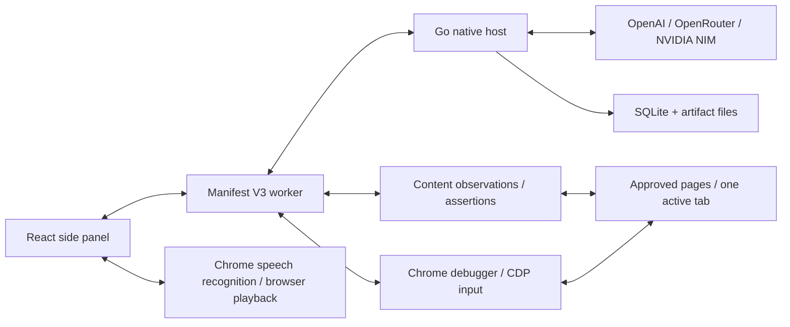

# Architecture

## Decisions

1. **Go owns durable state.** Runs, plans, baselines, and reports survive extension-worker restarts. Native Messaging avoids a public local HTTP endpoint.
2. **JavaScript owns browser execution.** Fixed content handlers observe and assert; CDP dispatches browser input. No model-generated code is evaluated.
3. **Planning is separate from verification.** Strict structured output creates a proposal. An exact plan version must be confirmed. Each case must contain an independent assertion.
4. **AI is bounded.** Model calls occur during planning and only when a target cannot be resolved. Known selectors replay without a model call, reducing cost and latency. Only a `target_missing` failure in click/fill/select permits re-grounding; ambiguous submissions never retry.
5. **Evidence is local and chunked.** Screenshots are redacted before transfer. Browser dictation updates only the unsent composer. Legacy audio uploads are deleted after transcription. Native messages stay under 512 KiB.
6. **One active tab and one run.** A page registry tracks up to five explicitly approved pages and run-created tabs. Generation tokens bind actions to the run and current tab. Planned switches detach/reattach the debugger and restore viewport metrics; unrelated focus changes pause actions. Host loss or unexpected debugger detachment stops execution.
7. **Protocol interruption does not imply an action failed.** Journal states distinguish dispatch from completion. Unknown outcomes require review.
8. **No required hosted browser.** Chrome runs the test in a selected QA profile. The local fixture makes the project demonstrable without paid model calls.

## Conversational interface

The React side panel has a fixed header and bottom composer with an independently scrolling conversation. The header exposes new chat, saved history and a settings gear. Settings contains only the AI provider and encrypted key. Model selection stays in the composer; origin-bound credentials live in Test options. The microphone uses Chrome recognition to fill an editable draft, never to submit or execute automatically. The composer holds the current-tab sharing chip, text/dictation controls, model selection and a progressive-disclosure test-options menu.

User requests, reviewable plan cards and streamed run records appear in the conversation. Plan confirmation still calls the original exact-version Go gate. During a run, the UI shows the live countdown and latest steps; completed runs expose their full records and existing exports. Export handlers use the specific displayed run ID, so older results do not export a newer run accidentally. Background events do not interrupt an open settings/history view.

The conversation is in-memory panel state; saved plans and run history remain durable in Go/SQLite. New chat clears the visible conversation and voice playback without deleting those records. Removing the sharing chip calls the worker's `unbind` handler, which clears the selected target after cleanup and rejects unsharing during an active run. The provider keys and browser execution pipeline are unchanged.

## Run states

`running` → `passed | failed | blocked | needs_review | error | cancelled`.

The extension separately tracks pauses caused by tab/window focus. The host remains cancellable while the browser executor waits. A missing visual baseline or evidence capture failure prevents an unequivocal pass. Original failures remain in the report.

Human checkpoints keep the run active with an explicit `handoff` containing a fresh ID, kind, instructions and page. The Go controller polls short browser replies every 500 ms while remaining cancellable. The UI acknowledgment is bound to that run/checkpoint identity. A separate assertion verifies the application outcome after acknowledgment.

Test authentication is implemented by Go's local encrypted profile store and RFC 6238 TOTP generator. AI receives only public profile metadata and plans credential references. The host resolves a reference against the actual page origin; browser execution checks that origin again immediately before entry. No public RPC returns a saved credential or generated code. See [advanced testing](ADVANCED_TESTING.md) for supported MFA and CAPTCHA paths.

## Workflow and security execution

The trusted panel request supplies mode, approved pages, public data rows and write authorization. The Go planner cannot enlarge that scope. A bounded structured call (up to 16,000 output tokens for complete multi-case plans, including provider reasoning) proposes fixed operations; local validation resolves every row, checks variable ordering and requires independent assertions. Authentication, transport and incomplete output do not trigger automatic retries. An invalid draft gets at most one repair under the same four-minute planning deadline/model. Planning alone streams Responses events using a context deadline rather than the ordinary 90-second HTTP body timeout; only a completed, locally validated result is saved. Sanitized phases and numeric output counts are tagged with the planning RPC ID. The five-minute companion RPC is nested inside 5.5-minute native and six-minute panel limits. Cancelled/stale results cannot revive a panel draft; no partial JSON or model reasoning is shown.

Each row/case receives fresh variables. DOM captures and selected public API scalars can supply later steps; URL interpolation escapes path/query data and JSON interpolation preserves JSON values. Credential profile references resolve locally. Named bearer and anti-CSRF sources resolve inside the browser immediately before a request; their actual values never enter the plan, model input or reports.

Browser-session API checks use fixed same-origin fetch with redirects blocked. The worker checks approved origin, generation, mode/write consent and the twenty-request limit. Mutations are never automatically retried. Only an expected status and bounded public scalar become evidence. Passive security indicators use allowlisted response headers and cookie flags, with values discarded. This implements scoped logical checks, not a general exploit engine or a security certification.

Run evidence carries page, viewport and data-row identity. A bounded network recorder retains request method/public URL/status/timing without request bodies or authentication headers. Deterministic triage suggests the next investigation from failed observations. Comparison matches case/label/page/viewport/row; plan reuse creates a new unconfirmed draft. Complete reports remain local even when a large live snapshot omits older steps. Separate private and visual-only masks protect secrets while allowing functional capture of changing public values.

CodeRabbit runs as a separate authenticated developer CLI against source changes, with ignored local review output and no vendor binary/customer keys in release archives. Local npm and Go vulnerability scans run in CI. Neither source review nor dependency scanning establishes application-level security. See [commercial-use boundaries](REVIEW_AND_COMMERCIAL_USE.md).

## Data model

SQLite migration version 1 uses a document-record table with `(kind,id)` primary keys and an append-only event table. Documents keep immutable plan versions and complete per-run snapshots. Indexed events carry sequence numbers. Artifacts live under opaque IDs in a fixed application directory; clients cannot request arbitrary filesystem paths.

## Optimization

- Compact visible controls (maximum 160) rather than full DOM uploads.
- Semantic/test IDs before AI re-grounding.
- One browser mutation at a time.
- Screenshots at assertions and failures, rather than every click.
- DOM assertions poll to explicit deadlines instead of fixed multi-second sleeps.
- Responsive tests use fixed CSS viewport widths without mobile page autoscaling, keeping pointer coordinates and overflow checks consistent.
- Bundled JavaScript validation generated at build time; no runtime `eval` required by schema compilation.
- Both Chrome communication layers use a generation-bound reconnectable port channel. Failed commands are rejected, never replayed; old-port disconnect events cannot close a replacement connection.
- Motion is limited to interaction/page feedback, with reduced-motion support. Inter is bundled locally (Latin subset), and Lucide icons are tree-shaken into the panel.
- SQLite WAL and one database connection avoid multi-writer contention.

## Desktop migration

Keep model providers, the controller, data records, assertion semantics, and reporting in Go. Replace Chrome-specific dispatch with a new desktop executor and wrap React views in a desktop shell. Grounding and desktop acceptance gates remain separate engineering work.
