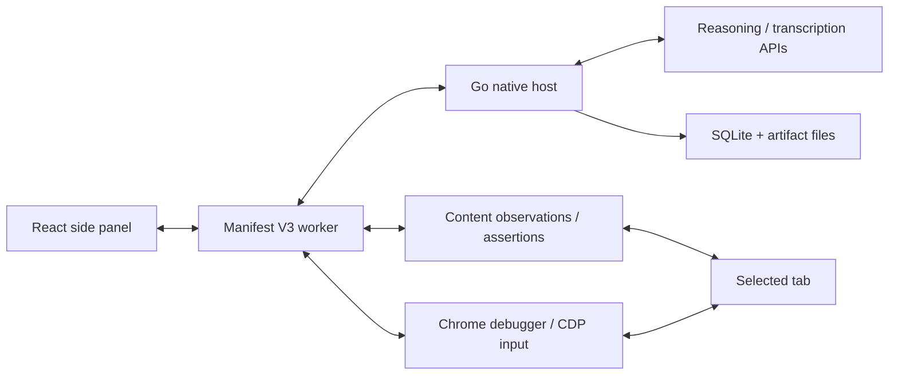

# Architecture

## Decisions

1. **Go owns durable state.** Runs, plans, baselines, and reports survive extension-worker restarts. Native Messaging avoids a public local HTTP endpoint.
2. **JavaScript owns browser execution.** Fixed content handlers observe and assert; CDP dispatches browser input. No model-generated code is evaluated.
3. **Planning is separate from verification.** Strict structured output creates a proposal. An exact plan version must be confirmed. Each case must contain an independent assertion.
4. **AI is bounded.** Model calls occur during planning and only when a target cannot be resolved. Known selectors replay without a model call, reducing cost and latency. Only a `target_missing` failure permits re-grounding; ambiguous submissions never retry.
5. **Evidence is local and chunked.** Screenshots are redacted before transfer. Audio is deleted after transcription. Native messages stay under 512 KiB.
6. **One tab and one run.** Identity and origin checks guard each browser request. Losing focus pauses actions; host loss or debugger detachment stops execution.
7. **Protocol interruption does not imply an action failed.** Journal states distinguish dispatch from completion. Unknown outcomes require review.
8. **No required hosted browser.** Chrome runs the test in a selected QA profile. The local fixture makes the project demonstrable without paid model calls.

## Conversational interface

The React side panel has a fixed header and bottom composer with an independently scrolling conversation. The header exposes new chat, saved history and a settings gear. API provider/model fields and separate speech credentials are inside Settings. The composer holds the current-tab sharing chip, text/voice controls, model settings and a progressive-disclosure test-options menu.

User requests, reviewable plan cards and streamed run records appear in the conversation. Plan confirmation still calls the original exact-version Go gate. During a run, the UI shows the live countdown and latest steps; completed runs expose their full records and existing exports. Export handlers use the specific displayed run ID, so older results do not export a newer run accidentally. Background events do not interrupt an open settings/history view.

The conversation is in-memory panel state; saved plans and run history remain durable in Go/SQLite. New chat clears the visible conversation and voice playback without deleting those records. Removing the sharing chip calls the worker's `unbind` handler, which clears the selected target after cleanup and rejects unsharing during an active run. The provider keys and browser execution pipeline are unchanged.

## Run states

`running` → `passed | failed | blocked | needs_review | error | cancelled`.

The extension separately tracks pauses caused by tab/window focus. The host remains cancellable while the browser executor waits. A missing visual baseline or evidence capture failure prevents an unequivocal pass. Original failures remain in the report.

## Data model

SQLite migration version 1 uses a document-record table with `(kind,id)` primary keys and an append-only event table. Documents keep immutable plan versions and complete per-run snapshots. Indexed events carry sequence numbers. Artifacts live under opaque IDs in a fixed application directory; clients cannot request arbitrary filesystem paths.

## Optimization

- Compact visible controls (maximum 160) rather than full DOM uploads.
- Semantic/test IDs before AI re-grounding.
- One browser mutation at a time.
- Screenshots at assertions and failures, rather than every click.
- DOM assertions poll to explicit deadlines instead of fixed multi-second sleeps.
- Responsive tests use fixed CSS viewport widths without mobile page autoscaling, keeping pointer coordinates and overflow checks consistent.
- Bundled JavaScript validation generated at build time; no runtime `eval` required by schema compilation.
- Both Chrome communication layers use a generation-bound reconnectable port channel. Failed commands are rejected, never replayed; old-port disconnect events cannot close a replacement connection.
- Motion is limited to interaction/page feedback, with reduced-motion support. Inter is bundled locally (Latin subset), and Lucide icons are tree-shaken into the panel.
- SQLite WAL and one database connection avoid multi-writer contention.

## Desktop migration

Keep model providers, the controller, data records, assertion semantics, and reporting in Go. Replace Chrome-specific dispatch with a new desktop executor and wrap React views in a desktop shell. Grounding and desktop acceptance gates remain separate engineering work.
