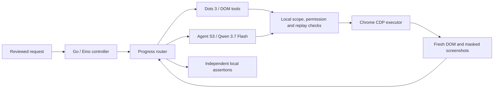

# Hybrid browser execution

Eino ADK remains the Go coordinator. Dots 3 operates DOM/CDP tools first. A pinned Simular Agent S3 Python worker uses `qwen/qwen3.7-flash` for visual decisions and screenshot grounding when DOM execution stalls. Both lanes share the approved mission, tab registry, action ledger and cancellation token. Only the extension sends browser input.



## Routing

- Live automation starts with DOM tools. Unchanged observations, repeated reads, rejected decisions or a nearly exhausted DOM-read budget can trigger visual recovery. A visual burst allows six decisions before returning to DOM tools; the run allows sixteen visual decisions. Successful assertions do not count as missing UI progress.
- Agent S proposes one typed intent: click, fill, a supported key, inspection, report, done or blocked. `done` returns control; it never establishes a pass. Existing completion-coverage review and local assertions gate success.
- Reviewed QA uses visual grounding after `target_missing`, before dispatch, for click/fill recovery. The approved operation, value and assertion expectations stay unchanged. Native select recovery retains the DOM path. Ambiguous dispatched mutations are not retried.
- Current-page investigation exposes read-only `visual_inspect`. Historical-run debugging continues to inspect the selected record and does not operate the current page.
- Dots availability failure retains the existing authorized Qwen fallback. Visual routing is separate from provider failover. Saved selections are preserved. Automatic visual routing requires the OpenRouter Dots/Qwen configuration and its saved key.

## Execution boundary

Agent S3 is pinned to `15776a8dc659658b1963816ea006f7af1978e595`, with Apache-2.0 license and source. The adapter uses its real AgentS3 worker with a custom browser ACI and bounded trajectory. All imported upstream action-evaluation aliases are replaced by a closed AST/literal dispatcher. No generated Python, shell, desktop shortcuts, wallet operations or arbitrary desktop actions execute.

[Qwen's endpoint](https://openrouter.ai/qwen/qwen3.7-flash) supports image input and computer-interaction workloads. This adapter uses Qwen for both reasoning and point grounding. It is a custom configuration, not the separate grounding-model configuration used by upstream Agent S benchmarks.

Masked screenshots bind input to a current document, tab, run, viewport, scroll position, focus and observed DOM revision, including open shadow roots. Coordinates are checked in the CSS viewport against the actual hit element. Private fields, private shadow ancestors and frame surfaces are blocked. Canvas actions require consequential-action permission because their internal semantics are opaque to the DOM. Existing origin, submission and replay checks apply. These are bounded safeguards, not guarantees against every hostile page or canvas-only redraw.

Capture preserves the current browser viewport. Visual recovery checks PNG dimensions against the viewport and DPI; cropped screenshots are rejected rather than stretched. Beyond-surface clipping was removed because Chrome can reset another CDP client's emulated viewport. Native-window acceptance uses a real viewport. Screenshot reads can retry a settling race before spending a model call. Chrome's debugger banner can consume vertical space. DPI conversion scales a full screenshot to CSS coordinates. Stale points are rejected.

## Setup

After `npm run build:all`, install Python 3.11 or 3.12 and run:

```powershell
powershell -NoProfile -ExecutionPolicy Bypass -File scripts/install-agent-s.ps1
```

Supply `-PythonPath C:\path\to\python.exe` if discovery is unavailable. The installer creates `dist/agent-s-runtime`, installs exact dependencies from `agent_s/requirements.txt`, and checks imports. `uv` is supported but optional. Python/dependencies are installed separately from the release archive. Native Tesseract is not used by this point adapter. Development can select a trusted runtime with `VOICEQA_AGENT_S_PYTHON`.

The existing encrypted OpenRouter key serves both models; no extra key setting is needed. Qwen charges can apply and mission review discloses visual recovery. Chrome Native Messaging remains length-prefixed JSON; the private Go/Python pipe uses newline-delimited JSON. Neither logs the key. The adapter adds no generation-token cap; provider limits, request deadlines and action budgets still apply.

## Actual AI acceptance, 2026-10-15

| Check | Result | Local evidence |
| --- | --- | --- |
| Qwen screenshot grounding, four target types at two viewport sizes | 8/8 independent hit/effect checks | `agent-s-grounding-ZSDnSh` |
| Agent S worker workflow | File, source, fixture compile control, canvas, done; independent state checks passed | `agent-s-worker-hUW1tx` |
| Extension → Eino → Dots → Agent S/Qwen → assertions | Final build passed, 15 steps, nine assertions, 75.7 seconds; width preserved | `paced-live-run-Yb7Ye4` |
| Read-only visual investigation | Correct canvas labels/colors, cited evidence, page unchanged | Same run, `visual-investigation.json` |
| Reviewed QA recovery | Actual Qwen recovered a missing target; unchanged visibility assertion passed | `paced-live-run-RFgUW9` |
| Real Remix screenshot grounding | Predicted point inside the actual preferences control; no click/consent/wallet action | `remix-real-grounding-wyQ4F0` |

Evidence is under `.tools/live-checks/`, excluded from Git with keys/profiles. Failed attempts remain failures. They exposed action-format parsing, premature visual handbacks, cropped screenshots and debugger/emulated-viewport conflicts; they are not counted as successful acceptance.

Validation also passed the Go race suite, 51 JavaScript checks, three restricted-dispatch checks and seven targeted Chrome regressions (planning chat, reconnect, microphone, privacy, IDE controls and repeated-run width). The broad browser run found stale heading/placeholder expectations from the earlier UI redesign; those selectors were updated. The entire 54-test suite is not claimed as a completed acceptance run.

Atlas Studio simulates compile/deploy controls. These results do **not** establish real Solidity compilation, EVM deployment, a complete Remix journey, arbitrary-site compatibility or a general GUI benchmark. The initial visual mutation surface is click/fill/supported keys. DOM tools handle navigation, scrolling, tabs and independent assertions. Frame surfaces and private controls gain no visual bypass.

Reproduce serially after starting `node tests/fixtures/visual-server.mjs`:

```powershell
node scripts/test-agent-s-grounding.mjs --live-paid
node scripts/test-agent-s-worker.mjs --live-paid
node scripts/test-agent-s-remix-grounding.mjs --live-paid
node scripts/test-live-run.mjs tests/fixtures/visual-live-plan.json --automation-live --fast --visual-agent --visual-investigate
node scripts/test-live-run.mjs tests/fixtures/visual-qa-plan.json --fast --visual-qa
node scripts/test-visual-guards.mjs
```

Model checks require paid Qwen authorization and a locally saved OpenRouter key. Scripts default to the installed `dist/agent-s-runtime`; `VOICEQA_AGENT_S_PYTHON` can select another trusted local runtime. `--fast` affects only the isolated acceptance profile. Native integration harnesses temporarily change Chromium registration, so run them serially; `finally` restores registration and removes copied encrypted key files.
