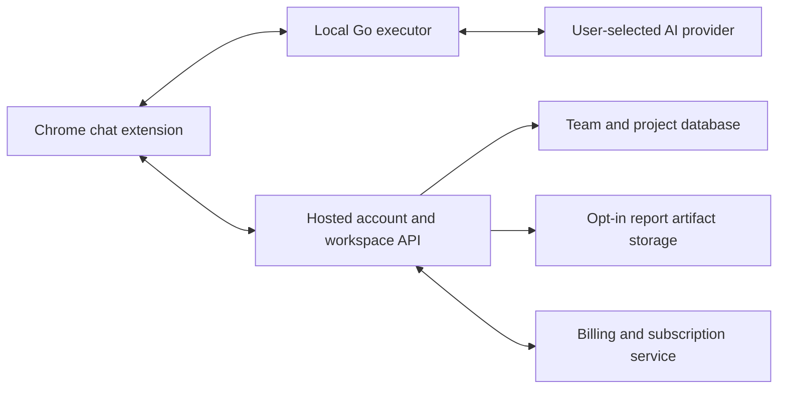

# VoiceQA micro-SaaS path

Yes: the existing Chrome extension and Go companion can become the execution client for a paid QA product. The present repository is a local MVP. Accounts, hosted workspaces, subscriptions, cloud synchronization and managed inference are not implemented.

## Initial product hypothesis

A QA copilot for freelance web developers and small web agencies: describe an acceptance test, review it, watch it run in your existing browser session, and share an evidence-backed report. Validate this with real users and varied websites before assuming repeat purchases or broad automation reliability. The demo shop is one verified workflow, not a market validation.

Keep the browser executor and provider keys on the user's computer for the first version. BYO OpenRouter/OpenAI credentials keep model costs directly visible to the customer. Charge for a hosted collaboration layer: reusable team suites, project history, shareable reports and approval workflows. Pricing is a customer-validation decision, not established by this prototype.

## Proposed architecture

Go can serve the new cloud API; React can provide the account/workspace site. A relational cloud database and object storage would serve shared data. Keep these separate from the existing local SQLite records and encrypted keys. Upload reports only when the user chooses to share them; never sync local provider credentials into team data.

## Implementation order

1. Test real-world reliability: forms, SPA navigation, loading states, dynamic lists, multiple tab widths, ambiguous targets and seeded failures. Measure false passes, failed grounding, cancellation and repeatability. General coverage is still an engineering task.
2. Make onboarding straightforward: a signed companion installer, browser registration, connection diagnostics and controlled updates. The current Windows/PowerShell setup is a pilot workflow.
3. Add hosted authentication, project/workspace isolation, membership roles and reusable suite versions. Keep local execution usable during temporary cloud outages.
4. Add explicit report upload/sharing, redaction review, retention/deletion controls, access permissions and audit records. Existing local masking does not by itself establish safe cloud sharing.
5. Integrate subscription billing, verified webhook events, customer self-service and server-enforced feature entitlements. Provider availability for the business's jurisdiction must be checked before choosing a billing vendor. See [Stripe's subscription lifecycle](https://docs.stripe.com/billing/subscriptions/overview) as an implementation reference, not a vendor-eligibility claim.
6. Publish an extension listing with accurate permissions and data disclosures. Chrome requires disclosure of user-data handling even when processing is local; page content and screenshots count as user data. See the [Chrome Web Store user-data FAQ](https://developer.chrome.com/docs/webstore/program-policies/user-data-faq).
7. Pilot with a small set of developers, record repeated use and support burden, and refine the paid feature set. Add managed AI credits or scheduled/headless execution only after provider-cost and reliability measurements justify them.

## What the current chat interface delivers

The extension now presents a compact chat workspace with a settings gear, a selected-tab sharing chip, voice/text composer, test options, inline plan confirmation and streamed execution results. The engine still uses explicit assertions, selected-origin boundaries and cancellable pacing. This UI improvement is implemented; the hosted architecture above is a proposed next phase.
